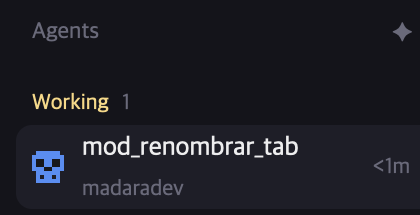

# tab-namer

Name your tabs with AI. Press `alt-shift-n` (or the ✦ button in the header of the Agents list) and the
active tab is renamed with a short lowercase name joined by underscores, like `fix_login_api`, written
by Claude from what is on the terminal screen. In the Agents list each row then reads: the tab name on
top, the space it belongs to below.

## What you see

**The Agents list** (the sidebar's `agents` block, edited; this part is an optional patch of the shipped
mod, `agents-two-line-rows.patch`):
- Header, 41 px tall: "Agents" (11.5 px, `dim`) on the left; on the right, a ✦ (`✦`, 13 px,
  `dim`, `foreground` on hover) and then the sort icon, 8 px apart. The ✦ tooltip is "Name the tab with
  AI (alt-shift-n)".
- Rows, 42 px tall (the shipped ones are 30), 8 px side padding, 8 px corners, 9 px between the icon
  and the text. Line 1: the tab name (13 px, `foreground`; `muted` for an idle agent that isn't
  focused), truncated. Line 2, 1 px below: the space name (11 px, `dim`), truncated. A tab with no name
  of its own (just a number) shows the program name instead. Then, on the right, how long ago the
  status changed (11 px, `dim`) and the status mark.
- The tab and space columns no longer join into one line ("space · tab"), in every sort mode,
  pinned rows included.

**The mod itself has no window**: it opens a 1 × 1 px popup and closes it as soon as it is done.
Everything it says goes through notifications (the `toast` mod).

## How it behaves

1. `alt-shift-n` runs `mod.open:tab-namer`; the ✦ button runs `run("mod.open", { name: "tab-namer" })`.
   Pressing either again while it works does nothing special (a second run just renames again).
2. It takes the active tab (`focused().tab`) and the terminal that gives context: the focused pane's
   terminal, else the tab's first agent, else its first terminal. No active tab → warning
   notification "There is no active tab."; no terminal → "This tab has no terminal.".
3. It posts an info notification "Naming tab…" (body: the space name, 4 s).
4. It reads the screen with `hc(["read", terminal])`, keeps the last 60 lines and at most 3500
   characters, and asks Claude. Prompt, in this order: give a short tab name of 1 to 3 words,
   lowercase, joined with underscores, no spaces or accents (example `fix_login_api`); reply with only
   the name; describe what the work is about, not the program; then `Folder:`, `Space:`, `Title:` and
   `Terminal screen:` with the text.
5. The answer is cleaned: first line only, accents removed (NFD, strip combining marks), lowercase,
   every run of characters outside `a-z0-9` becomes `_`, at most 3 words, at most 24 characters,
   trailing `_` trimmed. `run("tab.rename", { id, name })` applies it and a success notification
   "Tab renamed" (body: the name, 3 s) follows.
6. Any failure (no `claude`, signed out, no network, empty answer) → an error notification "Couldn't
   name the tab" with the last line of stderr, and the tab keeps its name.
7. The popup closes itself in every case (`closeOverlay(props().overlay)` once the work settles).

## Built from

- **Files:** `mods/tab-namer/mod.json`, `mods/tab-namer/main.js`, `keys.json`, and the optional
  `agents-two-line-rows.patch`.
- **`mod.json`:** `{ "place": "none", "title": "Name tab with AI", "overlay": { "kind": "popup", "at":
  "top", "width": 1, "height": 1 } }`. No layout block: it only opens through `mod.open`.
- **`main.js`:** one `View` whose `init` calls the async function above and whose `render` returns an
  empty `div()`. Imports `View, div` from `gpui-kit` and `focused, panes, spaces, run, exec, hc, props,
  closeOverlay, notify, home` from `herdr`. Constants `MODEL = "haiku"`, `MAX_CHARS = 24`,
  `MAX_WORDS = 3`. The cleaning function is exported as `clean`.
- **Key:** `keys.json` `{ "global": { "alt-shift-n": "mod.open:tab-namer" } }`.
- **Program it runs:** `exec("sh", ["-c", 'claude -p --model "$1" "$2" </dev/null', "sh", MODEL,
  prompt], { cwd: home() })`. The `</dev/null` matters: without it `claude -p` waits 3 s for piped
  input before going on. `exec` has a 30 s limit.
- **Agents patch:** against the shipped `agents` mod of Herdr App 0.1.13: in the row builder, replace the
  `full`/`name`/`more` logic and the one-line name block with a `v_flex` of two `div`s (tab name, space
  name), set the row `.h(42)`, and in the header wrap the sort icon and a new ✦ `div().id("ag-name")`
  in an `h_flex().gap(8)`.
- **Art:** none besides the ✦ character.

## Watch out

- **Privacy:** a fragment of the terminal screen (up to about 60 lines), the folder, the title and the
  space name go to Claude. Say so when adding the mod, and don't use it on a tab that shows secrets.
- It needs `claude` (Claude Code) installed and signed in; a sign-in that expires makes every run fail
  with an error notification.
- `exec` runs in the user's environment, so `claude` must be on the PATH that Herdr sees.
- Only the active tab, one at a time; no "rename all".
- The `popup` overlay must be tiny (1 × 1), or an empty box would flash on screen.
- The patch is made for the shipped `agents` of 0.1.13. If the person's `agents` has changed, do the same
  edit by hand rather than applying it blindly. The mod works without the patch (the key still does the
  renaming); only the two-line rows and the ✦ button are lost.
- The model may answer with a sentence; `clean` keeps only the first line and 3 words, so a bad
  answer gives an odd name, not an error. An answer with no letters at all counts as empty.

## Done when

- `herdr-app check mods/tab-namer` passes.
- With a tab open, `alt-shift-n` shows "Naming tab…" and, within a few seconds, "Tab renamed" with a
  name that matches `^[a-z0-9]+(_[a-z0-9]+){0,2}$`, at most 24 characters; the tab bar shows it.
- With `claude` unreachable (for example `PATH` without it), the same key shows "Couldn't name the tab"
  and the tab keeps its name.
- With the patch, each Agents row shows the tab name with the space name under it, rows are 42 px tall,
  and the ✦ button does the same as the key.
- `clean("  Fix Login: API\nextra")` returns `fix_login_api`, and `clean("")` returns `""`.
